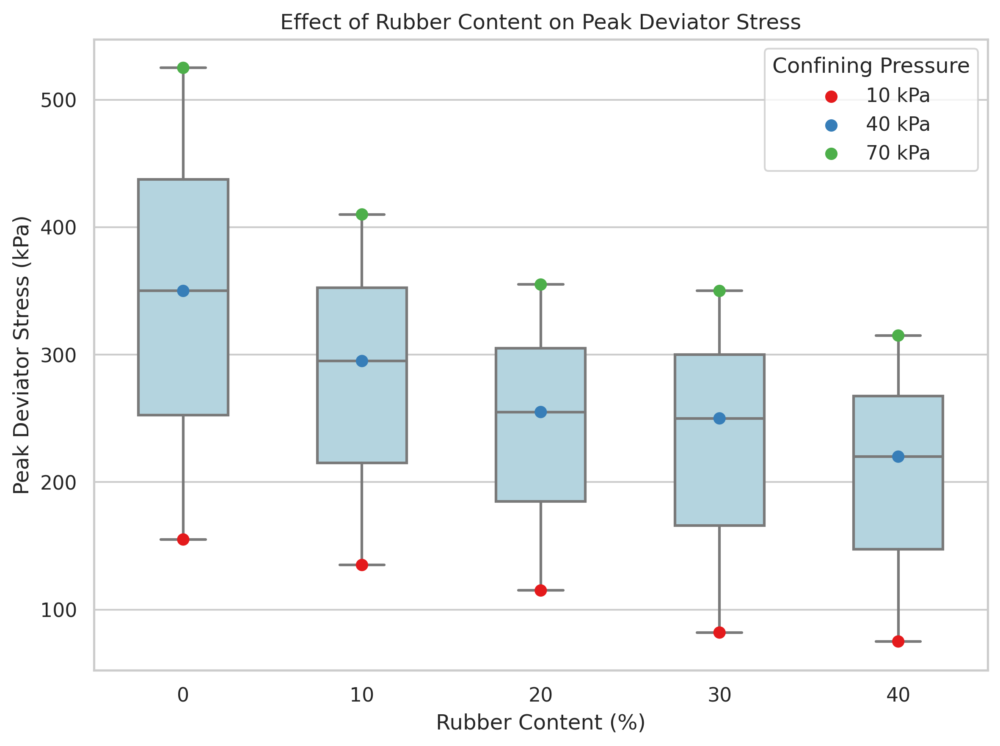
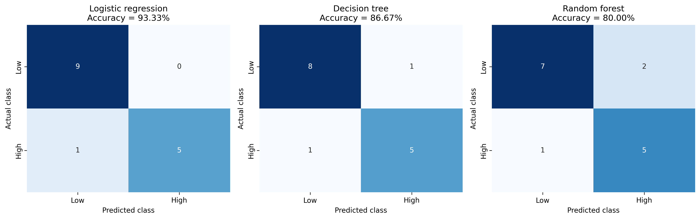

# Assignment 1B - Research Methods

This repository contains the practical learning artefacts
completed for Assignment 1B.

## Jupyter notebooks

[View Python and machine learning notebooks](https://github.com/FWANG8866/42069_FuzhiWang_Assignment-1b)

## Data visualisation

### RGM peak deviator stress

### Machine learning classification

## Data files

[View RGM experimental data](RGM_data.csv)

[View classification results](RGM_Classification_Results.csv)
